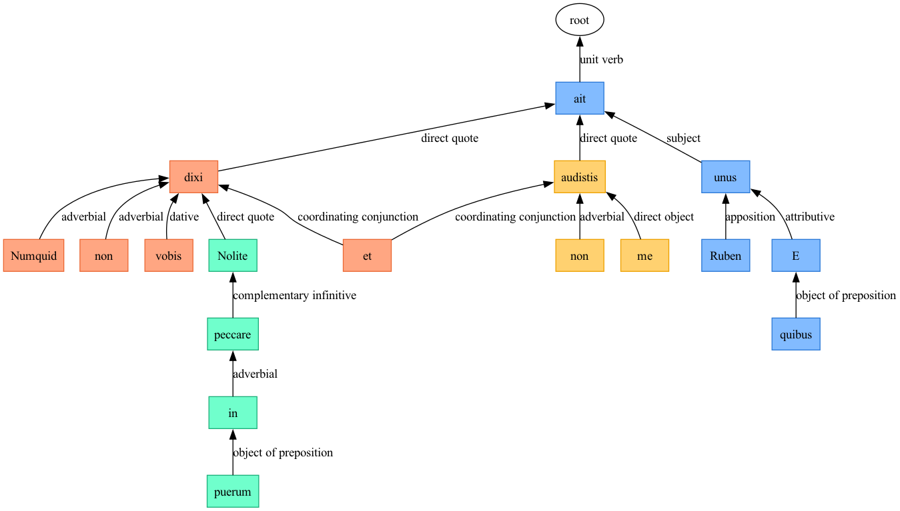

::: {.callout-warning}
## Document may be out of date
Content was generated with an earlier version of the `arsgrammatica` schema and needs to be regenerated to guarantee it matches the 1.0 specification.
:::

> E quibus unus Ruben, ait: Numquid non dixi vobis: Nolite peccare in puerum: et non audistis me?

::: {.callout-note collapse="true"}
### Expland to see table of tokens
*TBA*
:::
