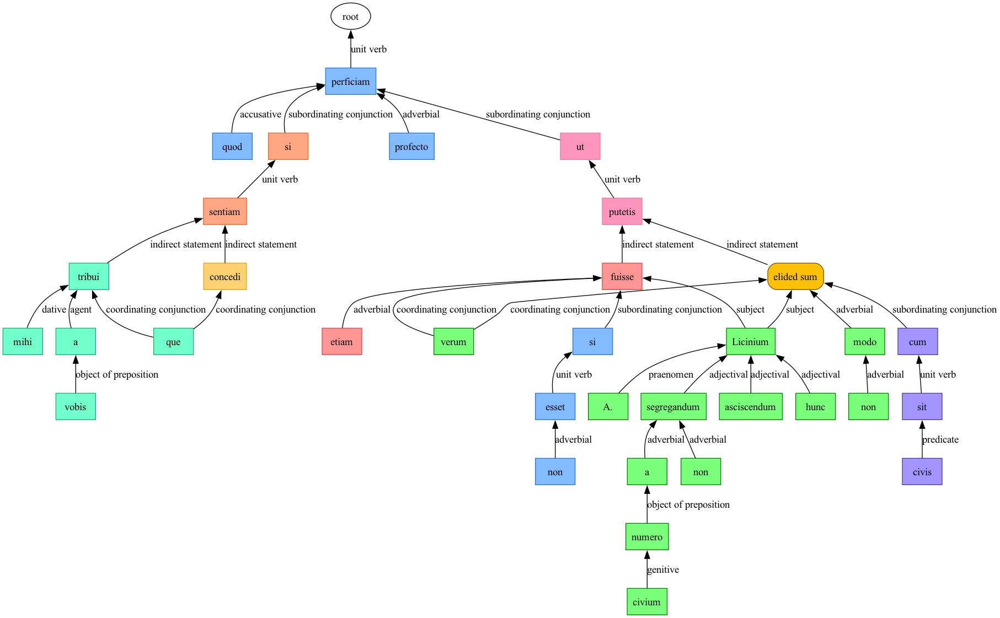

::: {.callout-warning}
## Document may be out of date
Content was generated with an earlier version of the `arsgrammatica` schema and needs to be regenerated to guarantee it matches the 1.0 specification.
:::

> quod si mihi a vobis tribui concedique sentiam, perficiam profecto ut hunc A. Licinium non modo non segregandum, cum sit civis, a numero civium verum etiam, si non esset, putetis asciscendum fuisse.

::: {.callout-note collapse="true"}
### Expland to see table of tokens
*TBA*
:::